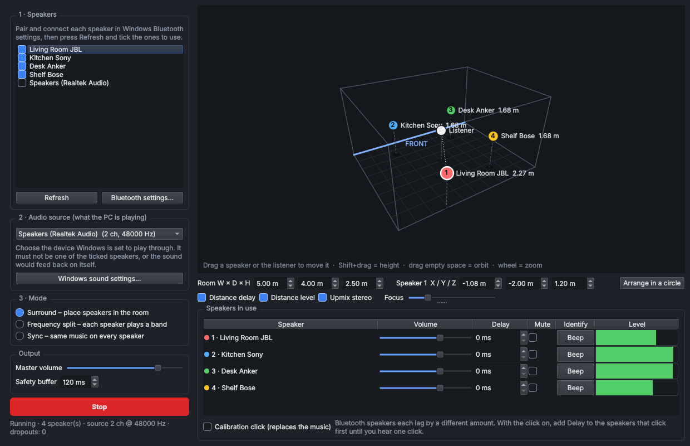

# RoomCast
RoomCast is a 3D spatial audio software for connecting multiple Bluetooth speakers to one device to enable surround sound functionality.



Play whatever your Windows PC is playing on several independent Bluetooth
speakers at once, in one of three modes:

| Mode | What it does |
| --- | --- |
| **Surround** | Place each speaker and the listener in a 3D model of the room. Each surround channel is sent to the speakers nearest its direction, and distance differences are compensated with delay and level. |
| **Frequency split** | Each speaker plays its own slice of the spectrum (for example lows on the big speaker, highs on the small ones). |
| **Sync** | Every speaker plays the same stereo music, time-aligned. |

## Running it

1. Install Python 3.10 or newer from python.org (tick "Add python.exe to PATH").
2. Double-click **RoomCast.exe** (or **Run RoomCast.bat**, which does the same
   thing). The first run creates a private `.venv` folder and downloads the
   packages in `requirements.txt`; later runs start immediately, with no
   console window.

`RoomCast.exe` is a small launcher that runs `Run RoomCast.bat`. It must stay in
the RoomCast folder. To rebuild it after changing `launcher/RoomCast.cs`, run
`launcher\build.bat` (no extra tools needed; it uses the C# compiler built into
Windows). Put a `RoomCast.ico` in `launcher/` before building to give it an icon.

## Using it

1. **Connect the speakers.** Press **Add a Bluetooth speaker…**, put the
   speaker in pairing mode and pair it from inside RoomCast (or use Windows
   Settings > Bluetooth). Tick the speakers to use. Each one shows its
   connection state and, if the speaker reports it, its battery level.
   Paired speakers that are switched off stay in the list with a
   **Reconnect** button.
2. **Pick the audio source.** RoomCast records what Windows sends to one
   output device and redistributes it. That device must *not* be one of the
   ticked speakers. Two good choices:
   - the PC's built-in output with its volume turned to zero, or
   - a virtual device such as VB-CABLE set as the Windows default output
     (cleanest: nothing audible plays except through RoomCast).
3. **Choose a mode and press Start.**
4. **Calibrate the timing.** Every Bluetooth speaker adds its own lag
   (typically 100–300 ms, different per model). Tick **Calibration click**,
   listen, and add **Delay** to the speakers that click first until all clicks
   land together. This is saved per speaker. Do this once in Sync mode before
   relying on Surround mode.

True 5.1/7.1 input is used when the source device is configured for it in
Windows; stereo sources are upmixed (optional).

**Connection problems are handled for you:**

- If a speaker drops out while playing, the others keep going (in Surround
  mode they take over its channels). The speaker rejoins automatically when
  Windows sees it again, with its delay and position kept.
- While playing, RoomCast asks Windows to reconnect ticked speakers that have
  disconnected, every 30 seconds (can be switched off).
- Speakers with a microphone show up in Windows twice; RoomCast hides the
  low-quality "Hands-Free" (phone call) output and warns when a speaker is
  stuck in that mode.

Many built-in Bluetooth adapters struggle with more than 2–3 speakers playing
at once, and Windows uses only one adapter at a time. A good USB Bluetooth
5.x adapter helps if speakers keep dropping out.

Expect roughly a quarter to half a second between the PC and the speakers.
That is fine for music, but video will be out of lip-sync unless the player
has an audio-offset setting.

## Architecture

```
 Windows audio mix ──WASAPI loopback──▶ backend.py ──▶ engine.Engine._process
                                                         │  surround: pan matrix (dsp.pan_gains)
                                                         │  frequency: dsp.BandFilter per speaker
                                                         │  sync: stereo downmix
                                                         ▼
                                    one engine.SpeakerOut per speaker
                                    (delay line + drift-correcting resampler)
                                                         │
                                 backend.py output stream per Bluetooth device
```

| File | Role |
| --- | --- |
| `main.py` | Entry point. |
| `ui.py` | Main window: device list, mode pages, per-speaker table, settings persistence (`%APPDATA%\RoomCast\settings.json`). |
| `room_view.py` | Orbitable 3D room editor drawn with QPainter (no OpenGL needed). |
| `engine.py` | Real-time routing. `Engine` turns each captured block into one signal per speaker; `SpeakerOut` holds it in a ring buffer and feeds that speaker's device callback. |
| `dsp.py` | Channel layouts, stereo upmix, direction-based panning, downmix, Butterworth band filters. |
| `backend.py` | WASAPI device listing, loopback capture and output streams (PyAudioWPatch). |
| `bluetooth.py` | Windows device APIs: endpoint state incl. disconnected paired speakers and hands-free detection (Core Audio via ctypes), one-shot Bluetooth reconnect (`IKsControl`), battery level (`cfgmgr32`), scanning and pairing (WinRT via `winrt-*`). No drivers or admin rights. |
| `connection.py` | `DeviceMonitor` (background polling: state every 2 s, battery every 30 s; runs reconnects off the GUI thread) and the pairing dialog. |

Key design points:

- **Independent clocks.** Each Bluetooth speaker consumes samples at a
  slightly different real rate. `SpeakerOut` measures how full its buffer is
  against a target and nudges its resampling ratio (at most ±0.5 %) to hold
  it there, so speakers neither drift apart nor run dry.
- **Delay = buffer target.** A speaker's delay is simply its target fill:
  safety buffer + distance compensation + manual delay. Large changes jump,
  small errors glide.
- **Surround panning.** Each virtual channel has a direction around the
  listener. A speaker's gain for it is `max(0, cos(angle between))^focus`,
  power-normalised across speakers, so any number and placement of speakers
  works. Coordinates: X = left/right, Y = towards the front wall, Z = height,
  in metres, origin at the centre of the floor.
- **Thread model.** The capture callback does the mixing and writes to the
  ring buffers; each device has its own output callback; the GUI thread only
  swaps settings (`Engine.apply`) and reads meters.
- **Dropout recovery.** A speaker whose device stops asking for audio for 1 s
  is closed on its own (`Engine.stalled` / `Engine.drop`). The window then
  restarts playback without it, re-scanning devices, and again when Windows
  reports it connected. A speaker that keeps failing is left out for longer
  each time (10 s up to 2 min).
- **Packages.** `Run RoomCast.bat` reinstalls packages whenever
  `requirements.txt` changes (it keeps a copy in `.venv\requirements.installed`).
