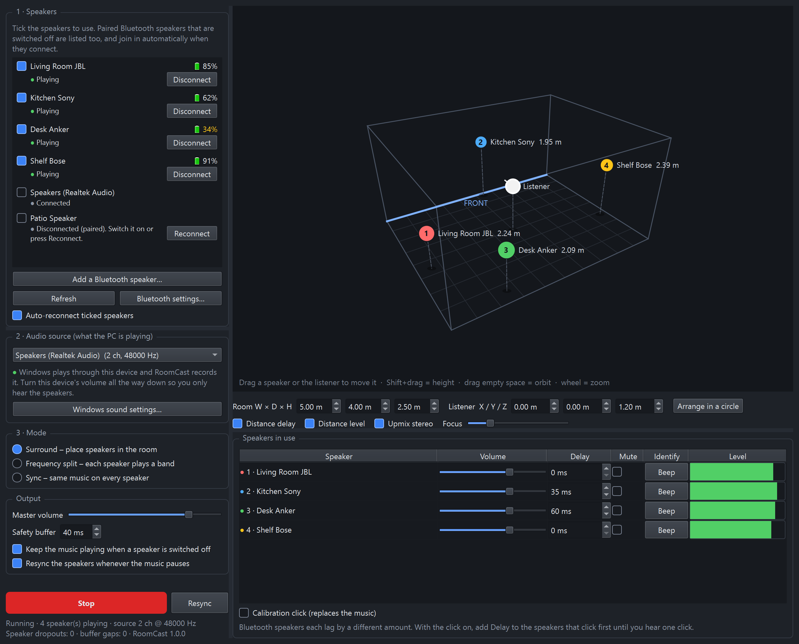

# RoomCast
RoomCast is a 3D spatial audio software for connecting multiple Bluetooth speakers to one device to enable surround sound functionality.



Play whatever your Windows PC is playing on several independent Bluetooth
speakers at once, in one of three modes:

| Mode | What it does |
| --- | --- |
| **Surround** | Place each speaker and the listener in a 3D model of the room. Each surround channel is sent to the speakers nearest its direction, and distance differences are compensated with delay and level. |
| **Frequency split** | Each speaker plays its own slice of the spectrum (for example lows on the big speaker, highs on the small ones). |
| **Sync** | Every speaker plays the same stereo music, time-aligned. |

## Running it

1. Install Python 3.10 or newer from python.org (tick "Add python.exe to PATH").
2. Double-click **RoomCast.exe** (or **Run RoomCast.bat**, which does the same
   thing). The first run creates a private `.venv` folder and downloads the
   packages in `requirements.txt`; later runs start immediately, with no
   console window.

`RoomCast.exe` is a small launcher that runs `Run RoomCast.bat`. It must stay in
the RoomCast folder.

## Using it

1. **Connect the speakers.** Press **Add a Bluetooth speaker…**, put the
   speaker in pairing mode, and press **Pair** as soon as it appears in the
   list (or use Windows Settings > Bluetooth). Tick the speakers to use. Each one shows its
   connection state and, if the speaker reports it, its battery level
   (🔋 – means the speaker doesn't report its battery to Windows; many
   speakers without a microphone don't).
   Connected Bluetooth speakers have a **Disconnect** button (they stay
   paired, and RoomCast won't reconnect them by itself until you press
   **Reconnect**). Paired speakers that are switched off stay in the list
   with a **Reconnect** button.
2. **Pick the audio source.** RoomCast records what Windows sends to one
   output device and redistributes it. That device must *not* be one of the
   ticked speakers. Two good choices:
   - the PC's built-in output with its volume turned to zero, or
   - a virtual device such as VB-CABLE set as the Windows default output
     (cleanest: nothing audible plays except through RoomCast).

   Windows makes a Bluetooth speaker its default output when it connects
   (especially right after pairing), so apps play straight to that one
   speaker and RoomCast hears nothing. While playing, RoomCast notices this
   and switches the Windows default back to the source device, with a note in
   the status line.
3. **Choose a mode and press Start.**
4. **Calibrate the timing.** Every Bluetooth speaker adds its own lag
   (typically 100–300 ms, different per model). Tick **Calibration click**,
   listen, and add **Delay** to the speakers that click first until all clicks
   land together. This is saved per speaker. Do this once in Sync mode before
   relying on Surround mode.

True 5.1/7.1 input is used when the source device is configured for it in
Windows; stereo sources are upmixed (optional).

**When a speaker drops out or is turned off:**

- The other speakers keep playing. In Surround mode, its channels move over
  to them.
- If turning a speaker off pauses your music, RoomCast starts it again on
  the remaining speakers within a few seconds. Pausing on purpose still
  pauses.
- When the speaker comes back, it rejoins by itself with its delay and
  position kept, and stays silent until it is in time with the others.
- RoomCast reconnects ticked speakers that have disconnected.
- All speakers are resynced whenever the music pauses. If they still sound
  out of step, press **Resync**: it pauses the music, lines the speakers up
  and carries on where it left off.
- Pressing **Stop** also pauses the music on your PC.

Most of these can be switched off with the checkboxes in RoomCast.

**Tips:**

- Disconnect phones from the speakers RoomCast uses. A connected phone, even
  an idle one, causes short dropouts.
- Built-in Bluetooth adapters often struggle with more than 2–3 speakers. A
  good USB Bluetooth 5.x adapter helps if speakers keep dropping out.
- Speakers with a microphone show up twice in Windows. RoomCast hides the
  low-quality "Hands-Free" output and warns if a speaker is stuck in it.

### Video and lip-sync

Expect roughly a quarter to half a second between the PC and the speakers:
the **Safety buffer** (120 ms by default, can be set as low as 0 ms if your
speakers play without dropouts) plus each speaker's own Bluetooth lag, which
RoomCast can't change. That is fine for music. For video it is not a
Bluetooth limit as such: when you play to a single Bluetooth speaker, Windows
tells the video player about the lag and the player holds the picture back.
Here the player only sees the source device, so it doesn't know about the
delay. Workarounds:

- **VLC:** Tools > Track Synchronization, set the audio track
  synchronization to a negative value (start at -0.350 s), or press **J** to
  adjust while watching. To keep it, set **Audio desynchronization
  compensation** (Tools > Preferences > All > Audio) to the same value in ms.
- **mpv:** add `audio-delay=-0.35` to `mpv.conf`, or adjust with
  **Ctrl + −** / **Ctrl + +**. With yt-dlp installed, mpv also plays YouTube
  links directly (`mpv <link>`), with the offset applied.
- **MPC-HC:** Options > Internal Filters > Audio Switcher > time shift.
- **Browsers, streaming apps and games** have no such setting. Lower the
  Safety buffer as far as your speakers allow, or play them straight to one
  speaker instead. Games can't hold the picture back in any case.

## Architecture

```
 Windows audio mix ──WASAPI loopback──▶ backend.py ──▶ engine.Engine._process
                                                         │  surround: pan matrix (dsp.pan_gains)
                                                         │  frequency: dsp.BandFilter per speaker
                                                         │  sync: stereo downmix
                                                         ▼
                                    one engine.SpeakerOut per speaker
                                    (delay line + drift-correcting resampler)
                                                         │
                                 backend.py output stream per Bluetooth device
```

| File | Role |
| --- | --- |
| `main.py` | Entry point. |
| `ui.py` | Main window: device list, mode pages, per-speaker table, settings persistence (`%APPDATA%\RoomCast\settings.json`). |
| `room_view.py` | Orbitable 3D room editor drawn with QPainter (no OpenGL needed). |
| `engine.py` | Real-time routing. `Engine` turns each captured block into one signal per speaker; `SpeakerOut` holds it in a ring buffer and feeds that speaker's device callback. |
| `dsp.py` | Channel layouts, stereo upmix, direction-based panning, downmix, Butterworth band filters. |
| `backend.py` | WASAPI device listing, loopback capture and output streams (PyAudioWPatch). |
| `bluetooth.py` | Windows device APIs: endpoint state incl. disconnected paired speakers and hands-free detection (Core Audio via ctypes), one-shot Bluetooth reconnect (`IKsControl`), battery level (`cfgmgr32`), scanning and pairing (WinRT via `winrt-*`). No drivers or admin rights. |
| `connection.py` | `DeviceMonitor` (background polling: state every 2 s, battery every 30 s; runs reconnects off the GUI thread) and the pairing dialog. |
| `pauseguard.py` | Watches media apps: resumes the music when a speaker switching off paused it, triggers the resync on pause, and pauses the music when RoomCast is stopped. |
| `diag.py` | Diagnostic log of connection events. |

Key design points:

- **Independent clocks.** Each Bluetooth speaker consumes samples at a
  slightly different real rate. `SpeakerOut` measures how full its buffer is
  against a target and nudges its resampling ratio (at most ±0.5 %) to hold
  it there, so speakers neither drift apart nor run dry.
- **Delay = buffer target.** A speaker's delay is simply its target fill:
  safety buffer + distance compensation + manual delay. Small errors glide.
  A speaker is jumped back into line only when it has been more than 40 ms
  off for over half a second, or when its delay setting changes, because
  Bluetooth links often pause and then catch up by themselves.
- **Surround panning.** Each virtual channel has a direction around the
  listener. A speaker's gain for it is `max(0, cos(angle between))^focus`,
  power-normalised across speakers, so any number and placement of speakers
  works. Coordinates: X = left/right, Y = towards the front wall, Z = height,
  in metres, origin at the centre of the floor.
- **Thread model.** The capture callback does the mixing and writes to the
  ring buffers; each device has its own output callback; the GUI thread only
  swaps settings (`Engine.apply`) and reads meters. Reopening a speaker that
  rejoins happens on its own short-lived thread (`Engine.rejoin`), and the
  GUI thread installs the result (`Engine.poll_rejoined`).
- **Dropout recovery.** A speaker is closed on its own (`Engine.drop`) when
  Windows reports it disconnected, or when its device stops asking for audio
  for 4 s (`Engine.stalled`). The others keep playing; in Surround mode the
  pan matrix is recomputed over the remaining speakers, while delay and level
  compensation still use all of them so nobody's timing moves. When the
  speaker returns, it is reopened on its existing device entry
  (`Engine.rejoin`) and gets its channels back once it has played steadily
  for 0.5 s. Pan changes always crossfade over 0.5 s. Only if reopening fails
  twice does the window restart playback to re-scan devices (at most once
  every 5 minutes per speaker); otherwise a speaker that keeps failing is
  retried less often each time (10 s up to 2 min).
- **Resync.** A rejoined speaker can be late from lag inside its Bluetooth
  link, which the ring buffer can't see. So it is held silent
  (`Engine.hold`) until it has played steadily for `SETTLE_S`, then reset
  once on its own (`MainWindow._reset_speaker`). The Resync button and every
  music pause (`PauseGuard.paused`) restart all speakers
  (`MainWindow._resync`).
- **Switched-off speakers (`pauseguard.py`).** Many speakers send a pause
  (AVRCP) as they switch off, and Windows only notices the speaker is gone
  after a ~20 s link timeout, during which Bluetooth to the other speakers
  stalls too. On a pause, `PauseGuard` sends each speaker a live Bluetooth
  query, one at a time. If every speaker answers, the pause was meant. If one
  answers and the next hangs, the one that hung is dropped at once. Either
  way the music is resumed, and the restart on pause frees the other
  speakers within about 4 s.
- **Nothing blocks the window.** Opening and closing streams run on
  background threads (`Engine.start`, `Engine.stop`, `Engine.drop`), since
  they can hang for many seconds while Bluetooth is stalled.
- **Diagnostic log.** Connection events go to `%APPDATA%\RoomCast\roomcast.log`
  (`diag.py`).
- **Unrelated device changes don't interrupt playback.** Endpoints that come
  and go without affecting playback (another speaker, a hands-free endpoint
  flickering because a phone connected to a speaker) just update the list.
- **Packages.** `Run RoomCast.bat` reinstalls packages whenever
  `requirements.txt` changes (it keeps a copy in `.venv\requirements.installed`).
